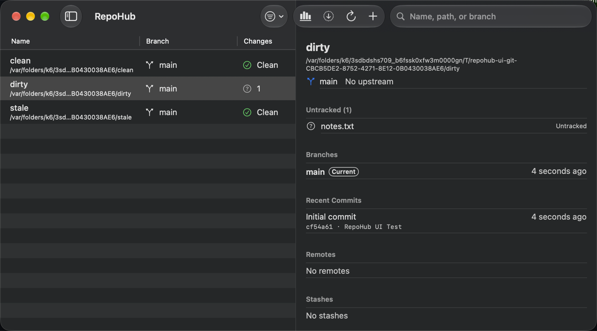

# RepoHub

[](https://github.com/lquainta/RepoHub/actions/workflows/ci.yml)
[](https://github.com/lquainta/RepoHub/actions/workflows/lint.yml)
[](https://github.com/lquainta/RepoHub/actions/workflows/codeql.yml)
[](https://codecov.io/gh/lquainta/RepoHub)
[](https://github.com/lquainta/RepoHub/actions/workflows/deploy.yml)
[](https://github.com/lquainta/RepoHub/releases/latest)

A native macOS dashboard for all your local git repositories: status, stale branches, pull requests, and CI at a glance.



**Production API:** <https://repohub-backend.fly.dev> ([`/health`](https://repohub-backend.fly.dev/health), [`/ready`](https://repohub-backend.fly.dev/ready), [API reference](https://repohub-backend.fly.dev/docs)) · **Code docs:** <https://lquainta.github.io/RepoHub/>

## What it does

- **Every repository in one table.** Add folders and RepoHub finds the git repositories inside them. For each one it shows the branch, uncommitted changes, ahead/behind, stashes, last commit, and stale branches. It refreshes when files change and fetches in the background if you want.
- **Details and actions:** changed files, branches, recent commits, remotes, and stashes. Fetch, fast-forward pull, open in your editor or terminal, and safely clean up merged or inactive branches.
- **Search, filters, and groups** ("School", "Work"). Groups sync between your Macs.
- **GitHub, once you sign in:** open pull requests, your review requests, and CI status for each checked-out branch, updated within seconds through webhooks. Notifications when CI fails or someone requests your review. A 30-day activity chart.
- **A menu bar summary**, **English and Spanish**, and VoiceOver and keyboard support.

Local repository status never leaves your Mac. The backend only stores what's needed for GitHub sign-in, sync, and the activity chart.

## Repository layout

| Path | Contents |
| --- | --- |
| `App/` | macOS SwiftUI app (XcodeGen project in `project.yml`) |
| `Packages/RepoHubCore/` | Git status, details, scanning, and branch cleanup; macOS and Linux ([docs](https://lquainta.github.io/RepoHub/core/documentation/repohubcore/)) |
| `Packages/RepoHubAPIClient/` | The app's API client, generated from the OpenAPI spec |
| `Backend/` | Vapor API: PostgreSQL, Redis, GitHub, webhooks ([docs](https://lquainta.github.io/RepoHub/backend/documentation/app/)) |
| `openapi/` | [`openapi.yaml`](openapi/openapi.yaml), the API's source of truth |
| `docs/` | [Architecture diagrams](docs/architecture/README.md), [database design](docs/architecture/database.md), [decision records](docs/adr/README.md), [deployment](docs/deployment.md), [testing](docs/testing.md), [configuration](docs/configuration.md), [accessibility](docs/accessibility.md) |

## Prerequisites

- **macOS 15** or later, and **Xcode 26** or later (Swift 6.2) for the app.
- Homebrew tools: `brew install xcodegen swiftlint gitleaks`. swift-format comes with Xcode.
- For the backend: **Docker** or [OrbStack](https://orbstack.dev) (`make up`), or the DevContainer below.

## Build and run the app

```sh
git clone https://github.com/lquainta/RepoHub.git && cd RepoHub
make bootstrap     # checks tools, installs git hooks, resolves packages, generates App/RepoHub.xcodeproj
make open          # opens the project in Xcode; run the RepoHub scheme (⌘R)
```

Or from the command line: `make build-app`. The app works without the backend. Sign-in, GitHub data, and sync use the production API by default. To use a local backend, set `REPOHUB_BACKEND_URL=http://localhost:8080` in the scheme's environment.

## Run the backend

**With docker compose** (PostgreSQL, Redis, migrations, and the API):

```sh
cp .env.sample .env    # optional; compose has working defaults
make up                # http://localhost:8080/health and /docs
make down
```

**From source**, against those databases: `make run-backend`. `make seed` fills the development database with sample data.

**In the DevContainer** (VS Code, Codespaces, or the `devcontainer` CLI): open the repository in the container, and the backend, RepoHubCore, and their databases are ready. See [`.devcontainer/README.md`](.devcontainer/README.md).

GitHub sign-in locally needs a GitHub OAuth app with the device flow enabled; put its `GITHUB_CLIENT_ID` in `.env`. Everything else works without it.

## Environment variables

Every variable the backend reads is listed with its purpose and default in [`.env.sample`](.env.sample), and CI fails if one is missing. Production values are Fly.io secrets, never in the repository. See [docs/configuration.md](docs/configuration.md) for environments (development, testing, production), secrets, and the app's settings.

## Test, lint, and format

```sh
make test               # RepoHubCore, the API client, the backend, and the app's unit tests
make test-integration   # backend tests against real PostgreSQL and Redis (after `make up`)
make test-ui            # UI, accessibility, and Spanish tests (drives the app)
make lint               # SwiftLint, strict
make format-check       # swift-format; `make format` fixes it
make check-localizations check-diagrams check-env lint-openapi
```

Git hooks (installed by `make bootstrap`) format, lint, scan for secrets, and check Conventional Commit messages before each commit. CI runs all of the above, plus CodeQL, coverage, benchmarks, and a Docker image test, on every pull request. [docs/testing.md](docs/testing.md) explains the test strategy.

## Deployment and releases

Every merge to `main` that passes CI deploys to Fly.io, with migrations first, then a smoke test, and a rollback if the smoke test fails. The database is backed up nightly. Versions and the changelog come from release-please. See [docs/deployment.md](docs/deployment.md) and [CONTRIBUTING.md](CONTRIBUTING.md#releases).

## Contributing

Every change starts from an issue and goes through a pull request with green checks. See [CONTRIBUTING.md](CONTRIBUTING.md) for the workflow, branch protection, the definition of done, and localization. Report security problems as described in [SECURITY.md](SECURITY.md).

## License

[MIT](LICENSE)
