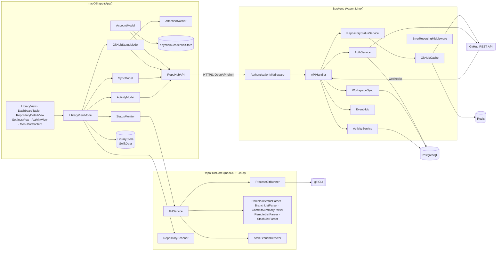
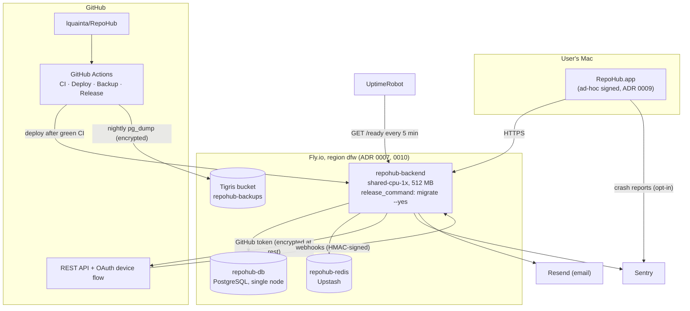

# Components and deployment

## Components

How the app, the shared package, and the backend fit together. Names are the
types in the code; `scripts/check-diagrams.sh` fails CI if one disappears.

## Deployment

