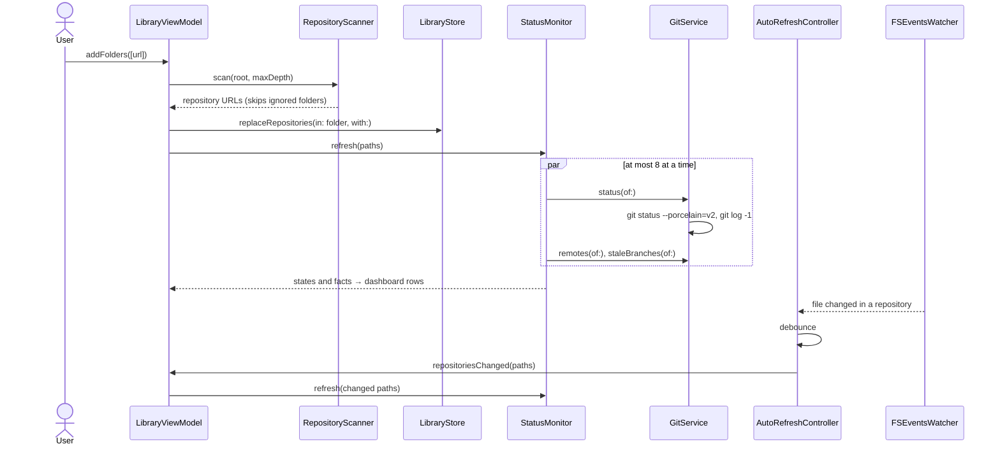
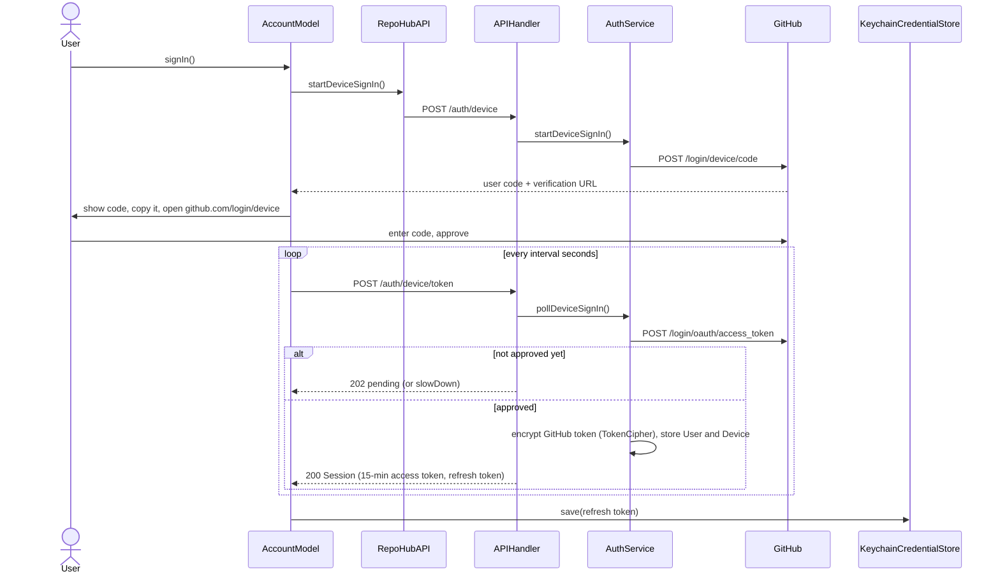
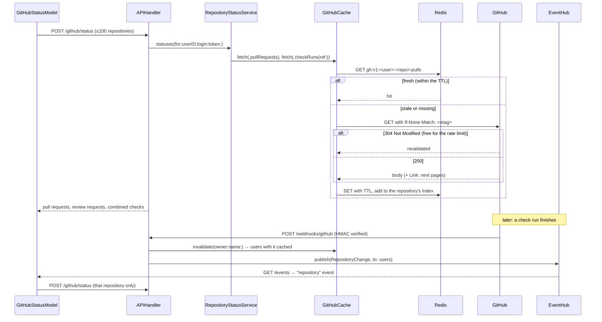
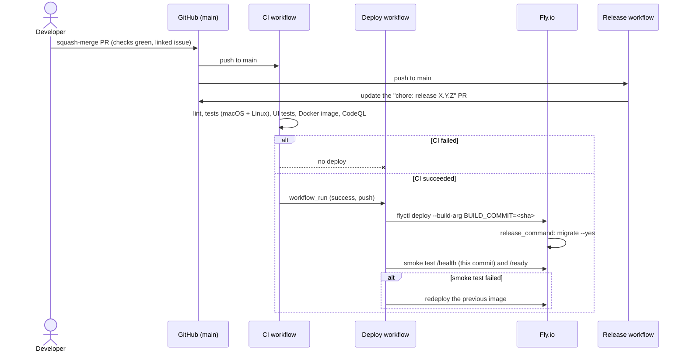

# Sequences

## Scanning and refreshing

Adding a folder, then refreshing statuses when files change (#17, #19, #70).

## GitHub sign-in (OAuth device flow)

The GitHub token stays on the backend; the app only holds a session (#49, #75).

## A cached GitHub request, and live updates

Pull request and CI badges, then a webhook pushing a change (#35, #76, #77).

## Continuous deployment

A merged pull request reaching production (#38, #43, #62).

